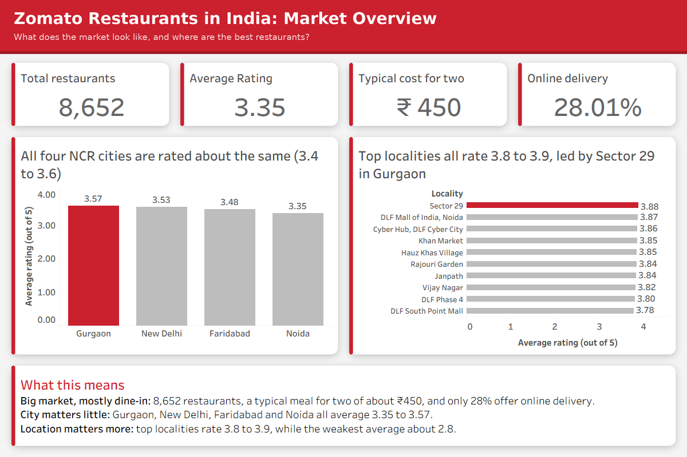
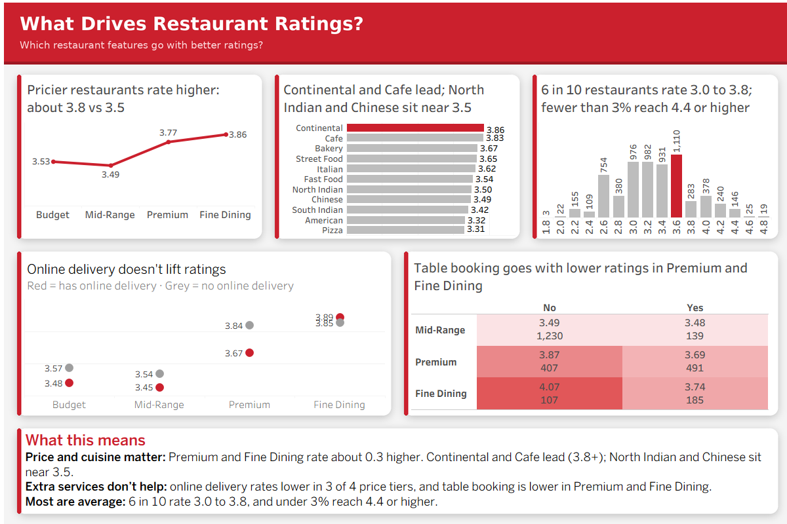
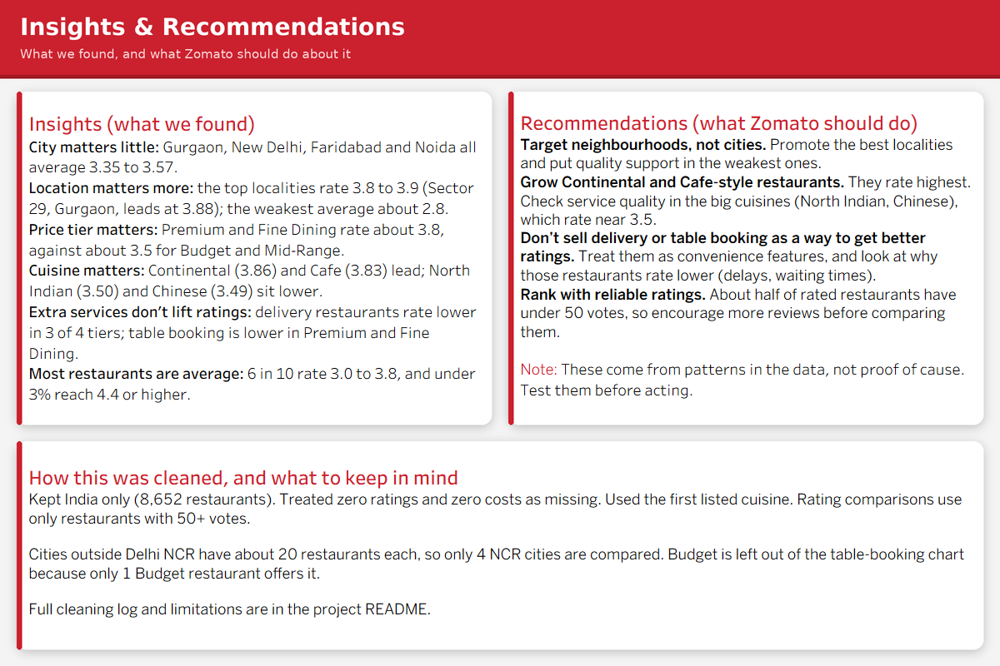

<div align="center">

# 🍽️ Zomato India: What Drives Restaurant Ratings?

### An interactive Tableau analysis of 8,652 restaurants across Delhi NCR




</div>

---

## 📌 Table of contents

1. [Business problem](#-business-problem)
2. [Key findings at a glance](#-key-findings-at-a-glance)
3. [Dashboards](#-dashboards)
4. [Recommendations](#-recommendations)
5. [Dataset](#-dataset)
6. [Data cleaning](#-data-cleaning)
7. [Design choices](#-design-choices)
8. [Limitations](#-limitations)
9. [Repository structure](#-repository-structure)
10. [How to open the workbook](#-how-to-open-the-workbook)

---

## 🎯 Business problem

**Category:** Food service and food-tech (restaurant discovery and delivery).

Zomato lists thousands of restaurants with very different ratings, prices, cuisines and services. It is not clear which factors go with higher ratings.

This project studies how **city, locality, cuisine, price tier, online delivery and table booking** relate to ratings, so Zomato can decide:

- 📍 Which **markets and neighbourhoods** to focus on
- 🍕 Which **restaurant types** to onboard or promote
- 🛵 Whether **pushing delivery or table booking** pays off

**Scope:** Indian restaurants, mainly Delhi NCR (other Indian cities have only about 20 restaurants each).

---

## ⚡ Key findings at a glance

| | Finding | Number |
|---|---|---|
| 🏙️ | **City matters little.** The four NCR cities are close | 3.35 to 3.57 average rating |
| 📍 | **Locality matters more.** Top localities vs the weakest | 3.8 to 3.9 vs about 2.8 |
| 💰 | **Price matters.** Fine Dining beats Budget | 3.86 vs 3.53 |
| 🍝 | **Cuisine matters.** Continental and Cafe lead, Pizza is lowest | 3.86 / 3.83 vs 3.31 |
| 🛵 | **Delivery does not mean better ratings.** Lower in 3 of 4 price tiers | e.g. Premium 3.67 vs 3.84 |
| 🪑 | **Table booking does not lift ratings** in Premium and Fine Dining | Fine Dining 3.74 vs 4.07 |
| 📊 | **Most restaurants are average.** Few are excellent | 61% rate 3.0 to 3.8, under 3% reach 4.4+ |

> ⚠️ These are **associations, not proof of cause**. For example, delivery and table-booking restaurants may simply be busier.

---

## 📊 Dashboards

### 1️⃣ Market Overview
*Where are the restaurants, and how do they rate?*


- **4 KPI cards:** 8,652 restaurants, average rating 3.35, typical cost for two ₹450, 28% offer online delivery
- **Rating by city:** Gurgaon 3.57, New Delhi 3.53, Faridabad 3.48, Noida 3.35
- **Top localities:** the top 10 rate 3.78 to 3.88, led by Sector 29 (Gurgaon)

### 2️⃣ What Drives Ratings
*Which restaurant features go with better ratings?*



| Chart | Type | What it shows |
|---|---|---|
| Rating by price tier | Line with dots | Budget 3.53, Mid-Range 3.49, Premium 3.77, Fine Dining 3.86 |
| Rating by cuisine | Horizontal bars | Continental 3.86 and Cafe 3.83 lead. North Indian 3.50, Chinese 3.49, Pizza 3.31 |
| Rating spread | Histogram | 3,999 of 6,513 rated restaurants sit between 3.0 and 3.8 |
| Online delivery | Dot plot | Delivery restaurants rate lower in 3 of 4 price tiers |
| Table booking | Heat map | No lift in Premium or Fine Dining |

### 3️⃣ Insights & Recommendations
*What should Zomato do with this?*



---

## ✅ Recommendations

1. **Focus on localities, not just cities.** Rating gaps inside a city (about one full point) are much larger than gaps between cities. Target high-rated localities such as Sector 29 for premium partnerships, and review weak localities for quality support.
2. **Promote Premium, Fine Dining, Continental and Cafe restaurants.** They carry the highest ratings, so featuring them can lift customer trust.
3. **Do not sell delivery or table booking as a rating booster.** Ratings are not higher for restaurants that offer them. Position them as convenience features instead.
4. **Help the large cuisines improve.** North Indian and Chinese are the biggest groups but rate near 3.5. A small quality gain there reaches many customers.
5. **Use rating plus vote count.** Many restaurants have few votes, so ranking on rating alone is misleading.

---

## 🗂️ Dataset

| | |
|---|---|
| **Source** | Zomato Restaurant Dataset (Kaggle), CSV |
| **Raw size** | 9,551 rows × 21 columns, 15 countries |
| **Used** | India only: **8,652 restaurants** |
| **Tool** | Tableau Desktop (checks cross-verified with pandas) |

---

## 🧹 Data cleaning

| # | Column | Issue | Fix | Why |
|---|---|---|---|---|
| 1 | Country Code | 15 countries, 12 currencies | Filtered to India | One country, one currency |
| 2 | Restaurant ID | Stored as a number | Changed to String | It is an identifier |
| 3 | Restaurant Name | 72 rows with broken characters | `REPLACE` plus manual aliases (6 names unrecoverable) | Corrupted in the source |
| 4 | Aggregate rating | 2,139 restaurants rated 0 | `Rating`: 0 becomes null | 0 means "not rated". Average moves 2.52 → 3.35 |
| 5 | Average cost for two | 9 zeros | `Cost (clean)`: 0 becomes null | Zero is missing data |
| 6 | Cuisines | Many cuisines in one cell | `Primary Cuisine` = first one listed | One cuisine per restaurant |
| 7 | Votes | About half of rated restaurants have under 50 votes | `Reliable Rating?` = Votes ≥ 50 | Few votes give unreliable ratings |
| 8 | Price range | Numbers 1 to 4 | `Price Tier`: Budget, Mid-Range, Premium, Fine Dining | Readable labels |
| 9 | Latitude / Longitude | 497 rows at 0,0 or invalid | Cleaned fields with nulls | Avoids points in the sea |
| 10 | City | Non-NCR cities have about 20 restaurants each | Compared 4 NCR cities only | Small samples are not comparable |
| 11 | Unused columns | No analytical value | Hidden, not deleted | Keeps the data pane clean |

<details>
<summary><b>Calculated fields (click to expand)</b></summary>

```
Rating            : IF [Aggregate rating] = 0 THEN NULL ELSE [Aggregate rating] END
Cost (clean)      : IF [Average Cost for two] = 0 THEN NULL ELSE [Average Cost for two] END
Primary Cuisine   : TRIM(SPLIT([Cuisines], ",", 1))
Reliable Rating?  : [Votes] >= 50
Price Tier        : CASE [Price range] WHEN 1 THEN "Budget" WHEN 2 THEN "Mid-Range"
                    WHEN 3 THEN "Premium" WHEN 4 THEN "Fine Dining" END
% Online Delivery : SUM(IF [Has Online delivery] = "Yes" THEN 1 ELSE 0 END) / COUNT([Restaurant ID])
Locality Rank     : RANK(AVG([Rating]))
```

</details>

---

## 🎨 Design choices

- **One highlight colour:** Zomato red `#CB202D` on greys (`#BDBDBD`, `#4A4A4A`) and a light background (`#F4F4F4`)
- **Chart titles are findings**, not labels, so a non-technical reader gets the point at once
- **Five different chart types** (line, bars, histogram, dot plot, heat map) instead of repeating one
- **Typical cost uses the median** (₹450), not the average (₹624), because a few expensive restaurants pull the average up
- **Rating comparisons use reliable ratings only** (50+ votes)
- **Bar charts start at 0.** Line and dot charts use a zoomed axis
- **Small groups removed:** localities and cuisines below a minimum restaurant count are filtered out; the table-booking chart excludes Budget (only 1 restaurant offers booking)
- **Fixed 1200 × 800 layout** over a custom background image

---

## ⚠️ Limitations

- Cities outside Delhi NCR have about 20 restaurants each and look like a sample
- 9 locality names (for example Sector 15, 17, 29) appear in two cities and are merged
- Price Tier labels are my interpretation of the 1 to 4 `Price range` values
- Only the first cuisine of each restaurant is used
- 6 restaurant names with broken characters could not be recovered
- The dataset is a snapshot, and its date is not stated

---

## 📁 Repository structure

```
zomato-india-tableau/
├── README.md
├── Zomato_india_Project_tableau.twbx     # Tableau packaged workbook
├── Zomato Restaurant Dataset.csv         # Source data (India subset used)
└── images/
    ├── dashboard-1-market-overview.png
    ├── dashboard-2-what-drives-ratings.png
    └── dashboard-3-insights-recommendations.png
```

---

## 💻 How to open the workbook

1. Download `Zomato_india_Project_tableau.twbx`
2. Open it in **Tableau Desktop** or the free **Tableau Public** app (data is packaged inside)
3. Use the three dashboard tabs at the bottom

---

<div align="center">

**Built by Ansari Mohd Rizwan** · [LinkedIn](https://www.linkedin.com/in/mohd-rizwan-ansari-3baa7b26a) · [GitHub](https://github.com/ansarimohdrizwan24-dev)

*If you found this useful, please ⭐ the repo.*

</div>
